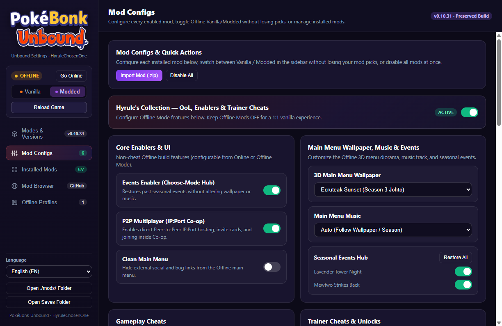
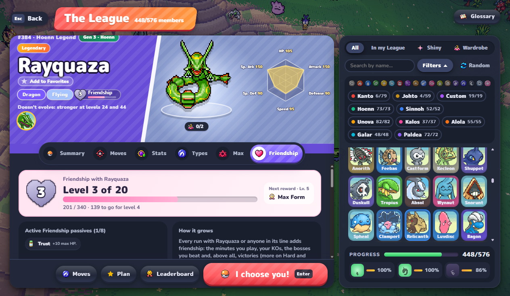

  

  Cross-platform client for <a href="https://pokebonk.com/">PokéBonk</a> (Windows, Linux / SteamOS, Android, iOS / iPadOS Sideload, plus Experimental macOS) featuring an isolated Online Mode, self-contained Offline Mode, multi-profile local saves, 11-language localization, P2P IP:Port Co-op, a built-in Mod Browser with Curated Modpacks, and a full Offline Modding Engine.

---

## Download (v1.1.0 — Complete Edition)

Download **PokéBonk Unbound Complete** below. Complete builds bundle the `v0.10.36` offline game build (`bundled-build.pak`), 3D models, Treasure wheels, and sprites so Offline Mode works immediately without an extra download.

All builds ship with **no pre-installed mods**. Install official mods, **Modpacks**, **Experimental Mods**, or approved **Community Mods** from **Unbound Settings -> Mod Browser**.

| Platform | Direct Download (Recommended) | Details |
| --- | --- | --- |
| **Windows (x64)** | **[Download PokeBonk-Unbound-Complete-1.1.0-win-x64.zip](https://github.com/HyruleChosenOne/Pokebonk-Unbound/releases/download/v1.1.0/PokeBonk-Unbound-Complete-1.1.0-win-x64.zip)** | Extract and run `PokéBonk Unbound.exe`. Online and Offline Mode ready out of the box. |
| **Linux / SteamOS (x64)** | **[Download PokeBonk-Unbound-Complete-1.1.0-linux-x64.tar.gz](https://github.com/HyruleChosenOne/Pokebonk-Unbound/releases/download/v1.1.0/PokeBonk-Unbound-Complete-1.1.0-linux-x64.tar.gz)** | Extract and run `./Pokebonk-Unbound.sh` (or add to Steam on Steam Deck for `1280x800` Gaming Mode). Includes `./install-desktop-shortcut.sh`. |
| **Android (7.0–17+ Universal)** | **[Download PokeBonk-Unbound-Complete-1.1.0.apk](https://github.com/HyruleChosenOne/Pokebonk-Unbound/releases/download/v1.1.0/PokeBonk-Unbound-Complete-1.1.0.apk)** | Universal 16 KB-aligned APK (`arm64-v8a`, `armeabi-v7a`, `x86_64`) with a floating **Unbound** button and mobile **Unbound Settings**. |
| **iOS / iPadOS (15.0+ Sideload)** | **[Download PokeBonk-Unbound-Complete-1.1.0.ipa](https://github.com/HyruleChosenOne/Pokebonk-Unbound/releases/download/v1.1.0/PokeBonk-Unbound-Complete-1.1.0.ipa)** | Unsigned `arm64` `.ipa` tested on iPad Pro. Install via AltStore, SideStore, Sideloadly, or TrollStore (see [iOS Sideloading Guide](docs/APPLE_EXPERIMENTAL.md#ios--ipados-unsigned-ipa-sideloading)). |

> Need a smaller download without bundled offline game files? See [Optional: Portable Editions (Nothing Included)](#optional-portable-editions-nothing-included) below, or view all builds on [Releases](https://github.com/HyruleChosenOne/Pokebonk-Unbound/releases).

### Experimental: macOS

> **Untested / Experimental**: macOS builds have not been tested on real Mac hardware yet. They are posted under **[Experimental: Apple](https://github.com/HyruleChosenOne/Pokebonk-Unbound/releases/tag/experimental-apple)** — see **[docs/APPLE_EXPERIMENTAL.md](docs/APPLE_EXPERIMENTAL.md)** for first-launch signing (`First-Time-Setup-macOS.command`).

| macOS Platform (Experimental) | Direct Download (Complete Edition) | Notes |
| --- | --- | --- |
| **macOS — Apple Silicon (`M1–M4`)** | **[Download PokeBonk-Unbound-Complete-1.1.0-mac-arm64.zip](https://github.com/HyruleChosenOne/Pokebonk-Unbound/releases/download/experimental-apple/PokeBonk-Unbound-Complete-1.1.0-mac-arm64.zip)** | Unsigned `.app` bundle + `First-Time-Setup-macOS.command` helper. |
| **macOS — Intel (`x64`)** | **[Download PokeBonk-Unbound-Complete-1.1.0-mac-x64.zip](https://github.com/HyruleChosenOne/Pokebonk-Unbound/releases/download/experimental-apple/PokeBonk-Unbound-Complete-1.1.0-mac-x64.zip)** | Unsigned `.app` bundle for Intel Macs + `First-Time-Setup-macOS.command`. |

---

## Showcase

<table>
  <tr>
    <td align="center" width="50%">
      
       
      <strong>1. Login Menu (Offline Profiles)</strong>
       
      Multi-profile local trainer picker right on the Offline start screen with instant access to Unbound Settings.
    </td>
    <td align="center" width="50%">
      
       
      <strong>2. Offline Main Menu</strong>
       
      Local multi-profile leaderboard, customizable 3D menu backgrounds, seasonal Events hub, and P2P Multiplayer.
    </td>
  </tr>
  <tr>
    <td align="center" width="50%">
      
       
      <strong>3. P2P Multiplayer (4-Player Co-op)</strong>
       
      Direct IP:Port peer-to-peer squads featuring modded Pokémon, live latency display, and automatic Gameplay mod parity.
    </td>
    <td align="center" width="50%">
      
       
      <strong>4. Hyrule's Collection (QoL &amp; Mod Configs)</strong>
       
      Per-mod configuration panel with Events Hub, P2P Co-op, custom 3D wallpapers &amp; music, Import Mod (.zip), and optional solo tools.
    </td>
  </tr>
  <tr>
    <td align="center" width="50%">
      
       
      <strong>5. Unbound Mod Browser &amp; Curated Modpacks</strong>
       
      1-click GitHub mod installs, Curated Modpacks (such as Gen 3–9 Complete Expansion), Grid/List views, Community mods, and Update All.
    </td>
    <td align="center" width="50%">
      
       
      <strong>6. Mod Showcase (Gen 3–9 Character Selection)</strong>
       
      Expanded character selection with filters for every generation (Kanto through Paldea + Custom) and hundreds of modded Pokémon.
    </td>
  </tr>
</table>

---

## Features

- **Cross-Platform Client (Windows, Linux / SteamOS, Android & iOS / iPadOS)**
  - **Windows & Linux (SteamOS / Steam Deck)**: Electron desktop client with an **Unbound Menu** button on the Offline main menu, an **Unbound Settings** button in the Pause Menu on modded clients, an optional native top toolbar toggled with `F1`, `1280x800` Steam Deck sizing, and Wayland/X11 auto-detection (`--ozone-platform-hint=auto`).
  - **Android (`minSdk 24` — Android 7.0 through Android 17+)**: Universal 16 KB page-size aligned APK (`arm64-v8a`, `armeabi-v7a`, `x86_64`) with mobile **Unbound Settings** (`Settings` | `Mods` | `Versions`) and an edge-docking **Unbound** button that hides during runs.
  - **iOS / iPadOS (`iOS 15.0+` arm64 Unsigned Sideload)**: `WKWebView` + embedded `--jitless` Node.js runtime with Portrait/Landscape & iPad multitasking support, Files app access, streaming `.zip` mod import, `AVAudioSession` recovery, and the mobile **Unbound Settings** UI.

- **Startup Homescreen, Singular Game Folder & Isolated Modes**
  - **Startup Homescreen & Singular Game Folder**: Pick **Online PokéBonk** or **Offline PokéBonk** (**Vanilla** or **Modded**) on launch with live/offline build indicators, a **Game Folder** picker above **Remember Choice** (defaults to the suggested folder or any custom directory), and an automatic executable shortcut created inside your desktop Game Folder so saves, builds, and mods stay in one place.
  - **Online Mode** loads `https://pokebonk.com/` in an isolated session (`persist:pokebonk-unbound-online`) with no script injection or request interception.
  - **Offline Vanilla Mode** runs locally from `127.0.0.1` with no custom assets or scripts, standard Vanilla PokéBonk patch notes, local multi-profile saves, and a **Requires Unbound** prompt on Co-op that can switch to Unbound and reload automatically.
  - **Offline Modded Mode** runs the Mod Engine, dual **Unbound + Vanilla PokéBonk** patch notes, **Vanilla Progression Isolation** (modded runs, custom regions, and custom Pokémon never change base progression or achievements unless an explicit unlock-all cheat is used), opt-in **Custom Pokédex & Achievements** for mods, and instant **Vanilla / Modded** switching without losing mod selections.
  - **Pause-Only Live Cheats (Hyrule's Collection)**: When solo cheats are enabled in Hyrule's Collection, live speed and combat cheat toggles appear in an inline Pause Menu drawer during solo runs with no HUD while playing.
  - One-click `.json` save export/import and read-only Online-to-Offline save sync.

- **11-Language Localization**
  - Supports all 11 PokéBonk languages (English, Español, Português, Français, Deutsch, Italiano, 日本語, 한국어, Русский, 简体中文, 繁體中文), synced with `pokebonk.lang` across Online Mode, Offline Mode, and Unbound Settings.

- **Multi-Profile Local Saves**
  - Create, switch, export (`.json`), import, and delete offline trainer profiles from the Offline login screen or **Unbound Settings**, with a Local Leaderboard across profiles on the device.

- **Direct IP:Port P2P Co-op, Co-op Expeditions (2–4P) & Mod Parity**
  - Host and join 2–4 player Co-op squads over LAN, VPN (Radmin VPN, ZeroTier, Tailscale), or port-forwarded IP:Port (`TCP 8080`), with UDP **Local Lobbies** discovery and a Host WebSocket relay fallback.
  - **Experimental Co-op Expeditions (2–4P)** (in **Hyrule's Collection**): Adds Expedition mode to Co-op lobbies and switches all squad members into the synced Co-op Expedition Base with solo loadout, shop, refuge, route card, and wishlist menus.
  - **Gameplay Mod Parity**: Checks that Host and joining players run matching **Gameplay** mods (characters, moves, levels, items) while letting **Client** mods (audio, themes, UI) differ freely, with 1-click **Download & Sync Required Mods** on mismatch.

- **Mod Browser, Modpacks, Community Mods & Collapsible Mods Config**
  - Install mods from GitHub in **Grid** or **List** view with **Starred / Featured / Most Downloaded** sorting, category filters, **Update All**, inline **Delete**, download counts, sizes, and preview lightboxes.
  - **Modpacks** tab for multi-mod bundles (such as **Gen 3–9 Complete Expansion** and **Classic Gen 1&2 Audio Collection**).
  - **Community Mods (`community-mods/`)**: Approved community submissions appear under the **Community** filter.
  - **Import Mod (`.zip`)** in **Mods Config** on Windows, Linux, Android, and iOS.
  - **Collapsible Mods Config**: Categories and individual mod modules minimize/expand with `Collapse All` / `Expand All`, and internal config files in `./mods/` stay hidden from **Manage Mods**.

- **Offline Modding Engine (`./mods/`)**
  - Core API support for custom playable characters (2D PMD sheets and 3D `.glb`/`.gltf` models, dual shinies, custom wardrobe, Ultimates, exclusive movesets), unplayable opt-in enemies, custom attacks and fusions, GPU VFX, custom stages (procedural terrain, interiors, 3D landmarks, boss waves, `.glb` arenas), map mechanics & prefabs, additive music/SFX and opt-in overrides, custom Treasures, Pokéball & shop items, declarative `i18n`, `configModule` panels, `window.pokebonkHooks`, and mod dependency/conflict checks.
  - See [docs/MODDING.md](docs/MODDING.md) for the full modding specification.

- **Offline Build History & In-App Updates**
  - Switch between the Preserved Build (`v0.10.36`) and synced live builds from `pokebonk.com`, **Rebuild Current Version**, or **Delete Past Versions**, with automatic mod compatibility checks.
  - **Check for Updates** pulls client updates directly from `HyruleChosenOne/Pokebonk-Unbound` GitHub Releases.

---

## Available Mods & Community Submissions

Mods are optional and installed on demand through **Unbound Settings -> Mod Browser** (or imported via `.zip` in **Mod Configs**).

- Browse the complete catalog of official mods, Curated Modpacks, descriptions, previews, and highlights in **[mods-datas.md](mods-datas.md)**.
- Want to submit your own mod for manual testing and inclusion in `community-mods/`? See **[community-mods/README.md](community-mods/README.md)** or click **Submit Mod** inside the Mod Browser.

---

## Shortcuts (Desktop)

- `F1` — Show / hide the optional native top toolbar (hidden by default; use the in-game **Unbound Settings** button anytime in Offline Mode)
- `F5` — Refresh the game
- `F11` — Toggle fullscreen

---

## Data Storage

All saves, profiles, installed mods, and downloaded offline builds (`saves/`, `mods/`, `build-data/`) are kept inside a single **Game Folder** chosen on the Startup Homescreen (with the suggested default pre-selected, or any custom folder):

- **Windows**: Defaults to `Documents\My Games\PokéBonk Unbound` (alternate preset `<Drive>:\Games\PokéBonk Unbound`, or any folder you pick). Creates `PokéBonk Unbound.lnk` inside the Game Folder pointing to the executable. Override with `POKEBONK_UNBOUND_DATA_DIR`.
- **Linux / SteamOS**: Defaults to `~/Games/PokéBonk Unbound` (alternate preset `~/Documents/My Games/PokéBonk Unbound`, or any custom folder). Creates a launcher shortcut inside the Game Folder. Override with `POKEBONK_UNBOUND_DATA_DIR`.
- **Android**: Kept in a single app folder (`.../files/PokéBonk Unbound`, or a custom folder chosen on the Homescreen), with native `.json` save export/import and `.zip` mod import.
- **iOS / iPadOS**: Defaults to `Documents/PokéBonk Unbound` (accessible in the iOS **Files** app under **On My iPhone / iPad -> PokéBonk Unbound**), with Document Picker `.json` save export/import and streaming `.zip` mod import.

---

## Modding Documentation

For `mod.json` / `info.json` schemas, custom characters (2D/3D), wardrobe skins, enemies, attacks, fusions, VFX, custom stages & map mechanics, additive/override audio, Treasures, Custom Pokédex & Achievements, `configModule` UI, `window.pokebonkHooks`, and Mod Browser publishing, see **[docs/MODDING.md](docs/MODDING.md)**.

---

## Optional: Portable Editions (Nothing Included)

Most players should download the **[Complete Edition](#download-v110--complete-edition)** above. Portable builds ship only the client shell without bundled offline game files — switching to Offline Mode downloads the live game build on demand into your Game Folder's `build-data/`.

| Platform | Optional Portable Download | Notes |
| --- | --- | --- |
| **Windows (x64)** | [PokeBonk-Unbound-Portable-1.1.0-win-x64.zip](https://github.com/HyruleChosenOne/Pokebonk-Unbound/releases/download/v1.1.0/PokeBonk-Unbound-Portable-1.1.0-win-x64.zip) | Lightweight archive + Online Mode; downloads Offline build on first switch. |
| **Linux / SteamOS (x64)** | [PokeBonk-Unbound-Portable-1.1.0-linux-x64.tar.gz](https://github.com/HyruleChosenOne/Pokebonk-Unbound/releases/download/v1.1.0/PokeBonk-Unbound-Portable-1.1.0-linux-x64.tar.gz) | Lightweight Linux/SteamOS archive; downloads Offline build on demand. |
| **Android (7.0–17+ Universal)** | [PokeBonk-Unbound-Portable-1.1.0.apk](https://github.com/HyruleChosenOne/Pokebonk-Unbound/releases/download/v1.1.0/PokeBonk-Unbound-Portable-1.1.0.apk) | Lightweight universal 16 KB-aligned APK; downloads Offline build on demand. |
| **iOS / iPadOS (15.0+ Sideload)** | [PokeBonk-Unbound-Portable-1.1.0.ipa](https://github.com/HyruleChosenOne/Pokebonk-Unbound/releases/download/v1.1.0/PokeBonk-Unbound-Portable-1.1.0.ipa) | Lightweight unsigned `arm64` `.ipa` shell; downloads Offline build on demand. |
| **macOS — Apple Silicon (Experimental)** | [PokeBonk-Unbound-Portable-1.1.0-mac-arm64.zip](https://github.com/HyruleChosenOne/Pokebonk-Unbound/releases/download/experimental-apple/PokeBonk-Unbound-Portable-1.1.0-mac-arm64.zip) | Experimental unsigned Apple Silicon shell; downloads Offline build on demand. |
| **macOS — Intel (Experimental)** | [PokeBonk-Unbound-Portable-1.1.0-mac-x64.zip](https://github.com/HyruleChosenOne/Pokebonk-Unbound/releases/download/experimental-apple/PokeBonk-Unbound-Portable-1.1.0-mac-x64.zip) | Experimental unsigned Intel Mac shell; downloads Offline build on demand. |

---

## Credits

- **PokéBonk** — Created by Charcher ([pokebonk.com](https://pokebonk.com/))
- **PMD Sprite Assets** — PMD SpriteCollab and community contributors
- **PokéBonk Unbound** — Built by HyruleChosenOne
