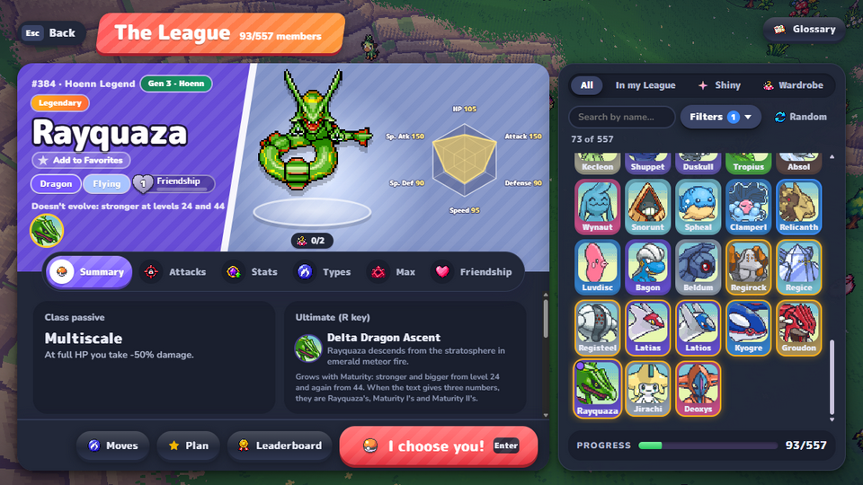
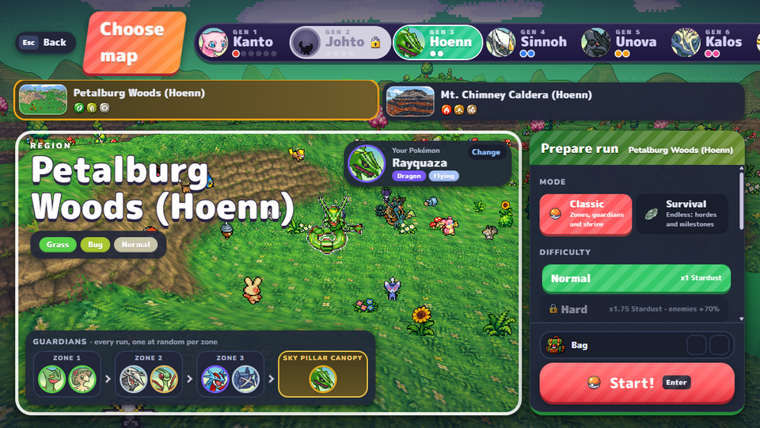
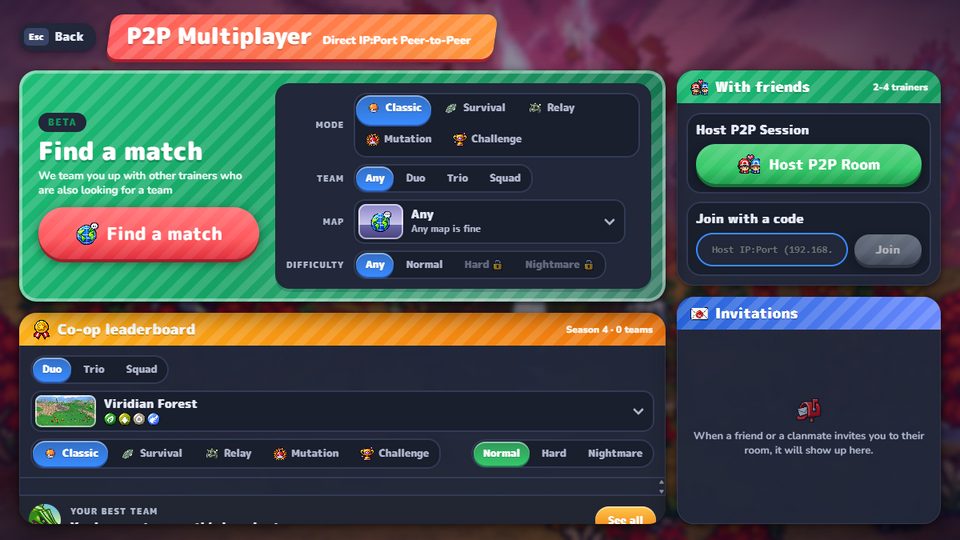
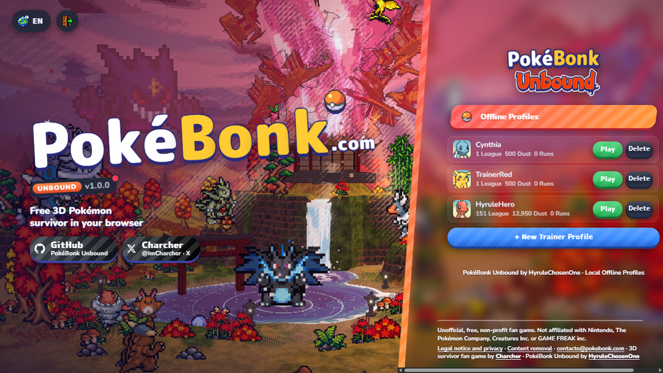
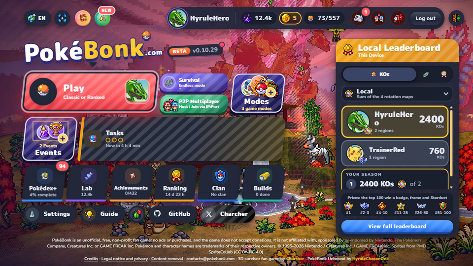
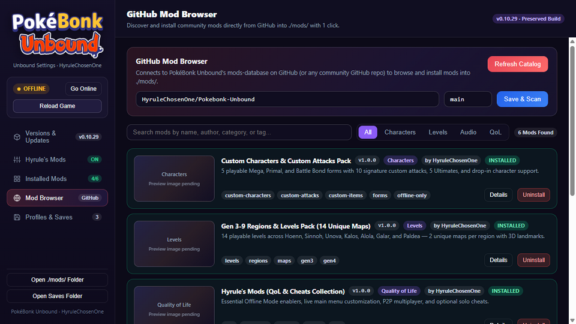

<p align="center">
  
</p>

<p align="center">
  Cross-platform desktop client for <a href="https://pokebonk.com/">PokéBonk</a> (Windows and Linux / SteamOS) with isolated Online Mode, self-contained Offline Mode, local build versioning, multi-profile saves, dynamic mod settings, in-app updates, and an offline modding engine.
</p>

---

## Features

- **Cross-Platform Desktop (Windows & Linux / SteamOS)**
  - **Windows & Linux (SteamOS / Steam Deck)**: Full Electron desktop client with native toolbar, dynamic status icons, `1280x800` Steam Deck support, and Wayland/X11 auto-detection (`--ozone-platform-hint=auto`).

- **Isolated Online Mode**
  - Runs `https://pokebonk.com/` in a dedicated, sandboxed browser session (`persist:pokebonk-unbound-online`) with no request interception and no injected scripts.
  - Online Mode stays 100% vanilla and never loads mods or touches online saves.
  - Non-cheat Offline mod settings can be configured in advance from **Unbound Settings** while in Online Mode; all gameplay-altering cheats (Run Speed, God Mode, Overdrive, Difficulty Unlocks) and save unlock tools remain strictly locked until you switch to Offline Mode.
  - Includes one-click Online savefile export and one-way sync to Offline Mode.

- **1:1 Vanilla Offline Mode**
  - Serves PokéBonk locally from `127.0.0.1` with local API emulation, a local-only multi-profile leaderboard, fresh **PokéBonk Unbound** release notes, and direct **GitHub** + **Creator X (`@ImCharcher`)** links on the menu.
  - Releases ship clean without bundled mods — Offline Mode runs pure 1:1 vanilla out of the box.

- **Multi-Profile Local Save System**
  - Create, switch, rename, import, export, and delete independent offline trainer profiles.
  - Logging out opens the profile chooser; if no offline profiles exist yet, you are prompted to enter a trainer name before starting.

- **Local Build Version History & Client Updates**
  - Maintain and switch between the bundled Preserved Build and synced Live Updates from `pokebonk.com` inside **Unbound Settings**.
  - Built-in **Check for Updates** queries `HyruleChosenOne/Pokebonk-Unbound` GitHub Releases and downloads/installs newer client versions right from the app.

- **Core Offline Modding Engine (`./mods/`)**
  - Built-in core API support for **Custom Attacks**, **Custom Visual Effects (VFX)**, **Additive Custom Music & SFX** (without replacing vanilla songs), **Custom Playable Characters** (8-direction animated spritesheets, shiny variants, portraits, icons, cries, and custom Ultimates), **Custom Stages & Regions**, **Custom Pokéball Items**, declarative **Mod Settings**, asset overrides, JSON data patches, bundle patches, scripts, and CSS.
  - See [docs/MODDING.md](docs/MODDING.md) for the complete modding reference.

- **Streamlined Unbound Settings, Dynamic Mod Settings & Mod Browser**
  - Clean desktop top toolbar (`Mode | Saves | Unbound Settings`) with dynamic status indicator icons.
  - Dynamic **Mod Settings** tab automatically populates settings, toggles, and actions for every currently enabled mod.
  - Built-in **Mod Browser** installs optional mods in 1 click directly from `mods-database/` in `HyruleChosenOne/Pokebonk-Unbound` or any custom GitHub `owner/repo`.

---

## Screenshots

<table>
  <tr>
    <td align="center" width="50%">
      <a href="docs/assets/screenshots/modding-gen3-9.png">
        
      </a>
      <br />
      <strong>Modding (Gen 3–9 National Dex)</strong>
      <br />
      <sub>Playable Hoenn–Paldea roster, custom Gen 3–9 attacks, and signature Ultimates.</sub>
    </td>
    <td align="center" width="50%">
      <a href="docs/assets/screenshots/custom-levels.png">
        
      </a>
      <br />
      <strong>Modding (Gen 3–9 Regions &amp; Levels)</strong>
      <br />
      <sub>14 playable maps across 7 regions with unique terrain, sanctuaries, and 3D landmarks.</sub>
    </td>
  </tr>
  <tr>
    <td align="center" width="50%">
      <a href="docs/assets/screenshots/p2p-coop.png">
        
      </a>
      <br />
      <strong>P2P Online (Direct IP:Port Co-op)</strong>
      <br />
      <sub>Functional peer-to-peer co-op hosting and joining via IP:Port.</sub>
    </td>
    <td align="center" width="50%">
      <a href="docs/assets/screenshots/profiles.png">
        
      </a>
      <br />
      <strong>Offline Profiles</strong>
      <br />
      <sub>Compact multi-profile local save chooser right on the Offline start screen.</sub>
    </td>
  </tr>
  <tr>
    <td align="center" width="50%">
      <a href="docs/assets/screenshots/offline-menu.png">
        
      </a>
      <br />
      <strong>Offline Main Menu &amp; Local Leaderboard</strong>
      <br />
      <sub>Local multi-profile leaderboard, restored Seasonal Events hub, and P2P Co-op.</sub>
    </td>
    <td align="center" width="50%">
      <a href="docs/assets/screenshots/unbound-mod-browser.png">
        
      </a>
      <br />
      <strong>Unbound Settings &amp; Mod Browser</strong>
      <br />
      <sub>1-click GitHub mod installs, version history, and per-mod configuration.</sub>
    </td>
  </tr>
</table>

---

## Release Editions (v1.0.0)

Clean builds for **Windows** and **Linux / SteamOS** are provided on the [Releases](https://github.com/HyruleChosenOne/Pokebonk-Unbound/releases) page. Neither Portable nor Complete comes bundled with mods — install any optional mod with 1 click through **Unbound Settings -> Mod Browser**.

| Platform | Edition | Output File | Bundled PokéBonk Version | Notes |
| --- | --- | --- | --- | --- |
| **Windows (x64)** | **Portable** | `PokeBonk-Unbound-Portable-1.0.0.exe` | Downloaded on demand | Lightweight shell + Online Mode; switching to Offline Mode downloads the latest live build into `./build-data/`. |
| **Windows (x64)** | **Complete** | `PokeBonk-Unbound-Complete-1.0.0.exe` | **PokéBonk `v0.10.29`** (build `mwtpofww`) | Self-contained executable bundling the complete `v0.10.29` offline build and sprites out of the box (updatable anytime). |
| **Linux / SteamOS (x64)** | **Portable** | `PokeBonk-Unbound-Portable-1.0.0-linux-x64.tar.gz` | Downloaded on demand | Extract and run `./Pokebonk-Unbound.sh` (or add to Steam as a Non-Steam Game on Steam Deck). Includes `./install-desktop-shortcut.sh`. |
| **Linux / SteamOS (x64)** | **Complete** | `PokeBonk-Unbound-Complete-1.0.0-linux-x64.tar.gz` | **PokéBonk `v0.10.29`** (build `mwtpofww`) | Self-contained Linux/SteamOS archive bundling the complete `v0.10.29` offline build and sprites (zero bundled mods). |

### Platform Quick Start

- **SteamOS / Steam Deck**: Extract the `.tar.gz` in Desktop Mode, run `./Pokebonk-Unbound.sh` (or `./install-desktop-shortcut.sh`), or right-click `Pokebonk-Unbound.sh` -> **Add to Steam** to launch from Gaming Mode (`1280x800` supported natively).

---

## Available Mods

Mods are not bundled in the releases and are installed on demand through **Unbound Settings -> Mod Browser**.

For the full catalog of official available mods, descriptions, preview images, and highlights, see **[mods-datas.md](mods-datas.md)**.

---

## Shortcuts

- `F1` — Show / hide the top native toolbar
- `F11` — Toggle fullscreen
- `Alt+Left` / `Alt+Right` — Browser back / forward

---

## Data Storage

- **Windows**:
  - Offline Build Data (`versions/`, `pokeapi/`, `pokeapi-sprites/`): `./build-data/` beside the `.exe` (fallback `%APPDATA%\pokebonk-unbound\build-data`). Override with `POKEBONK_UNBOUND_BUILD_DIR`.
  - Saves, Profiles, Mods & Sessions: `%APPDATA%\pokebonk-unbound` (also reads `./mods/` beside the `.exe` if present). Override with `POKEBONK_UNBOUND_DATA_DIR`.
- **Linux / SteamOS**:
  - Offline Build Data: `./build-data/` beside the extracted folder or AppImage (fallback `~/.config/pokebonk-unbound/build-data`).
  - Saves, Profiles, Mods & Sessions: `~/.config/pokebonk-unbound` (also reads `./mods/` beside the folder if present).

---

## Building from Source

Requires Node.js 20+ and npm.

```bash
npm install
```

### Run in Development

```bash
npm start
```

### Bundle the Complete Offline Build (Required for Complete Editions)

The repository excludes the upstream PokéBonk build files (`bundled-build/`). To download and package a local copy from `pokebonk.com`:

```bash
npm run bundle:offline
```

### Run Verification Tests

```bash
npm test
```

### Build Platform Releases

```bash
# Windows Portable & Complete (.exe)
npm run build:portable
npm run build:complete

# Linux / SteamOS Portable & Complete (.tar.gz / .AppImage on Linux)
npm run build:linux:portable
npm run build:linux:complete
```

---

## Modding Documentation

For mod creation, `mod.json` and `info.json` showcase schemas, core custom attacks, custom visual effects (VFX), additive custom music & SFX, custom characters, custom Pokéball items, and GitHub Mod Browser publishing, see **[docs/MODDING.md](docs/MODDING.md)**.

---

## Credits

- **PokéBonk** — Created by Charcher ([pokebonk.com](https://pokebonk.com/))
- **PMD Sprite Assets** — PMD SpriteCollab and community contributors
- **PokéBonk Unbound** — Built by HyruleChosenOne
