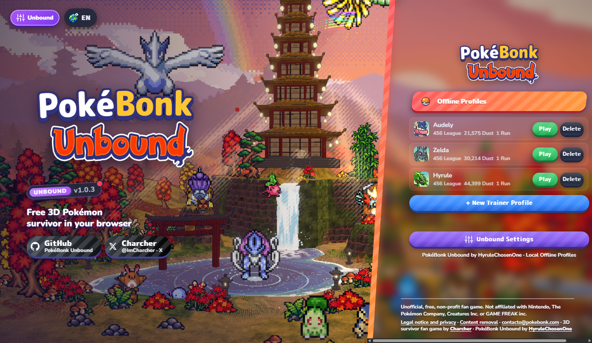
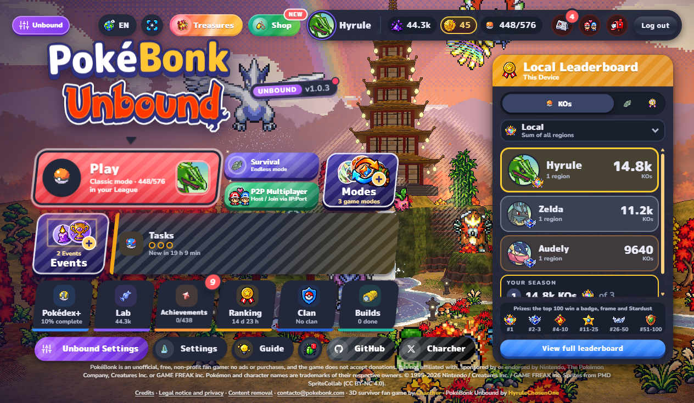
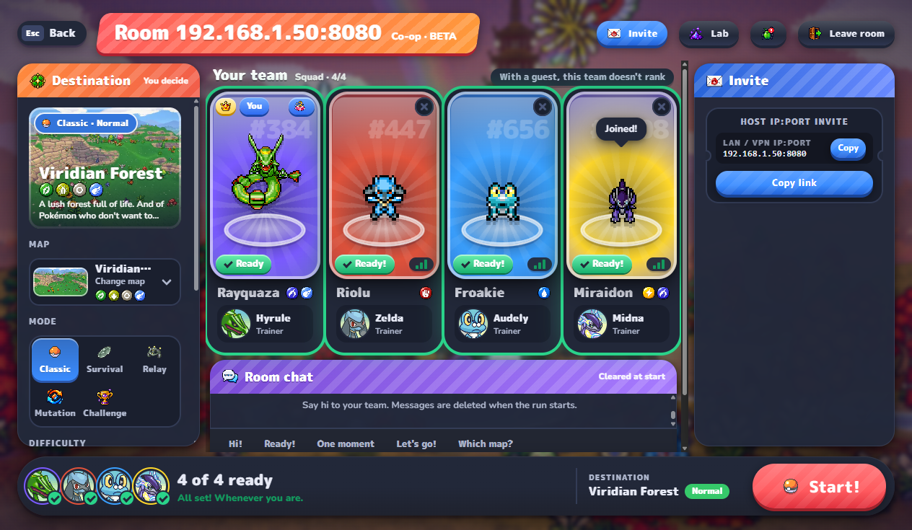
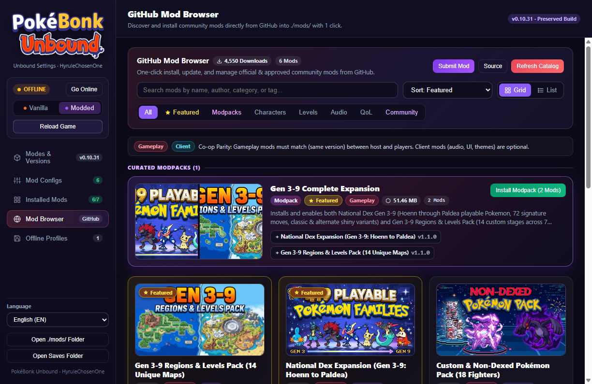

  

  Cross-platform client for <a href="https://pokebonk.com/">PokéBonk</a> (Windows, Linux / SteamOS, Android, plus Experimental macOS &amp; iOS Sideload) featuring an isolated Online Mode, self-contained Offline Mode, multi-profile local saves, 11-language localization, P2P IP:Port Co-op, a built-in Mod Browser with Curated Modpacks, and a full Offline Modding Engine.

---

## Download (v1.0.5 — Complete Edition)

Download **PokéBonk Unbound Complete** directly below. Complete builds bundle the full `v0.10.31` offline game client, all 74 3D models, all 12 Treasure wheels, and sprites so Offline Mode works immediately with zero extra setup.

All builds ship clean with **no pre-installed mods** — install official mods, **Curated Modpacks**, or approved **Community Mods** in 1 click anytime from **Unbound Menu -> Mod Browser**.

| Platform | Direct Download (Recommended) | Details |
| --- | --- | --- |
| **Windows (x64)** | **[Download PokeBonk-Unbound-Complete-1.0.5.exe](https://github.com/HyruleChosenOne/Pokebonk-Unbound/releases/download/v1.0.5/PokeBonk-Unbound-Complete-1.0.5.exe)** | Self-contained Windows executable with instant launch splash, Online & Offline Mode ready out of the box. |
| **Linux / SteamOS (x64)** | **[Download PokeBonk-Unbound-Complete-1.0.5-linux-x64.tar.gz](https://github.com/HyruleChosenOne/Pokebonk-Unbound/releases/download/v1.0.5/PokeBonk-Unbound-Complete-1.0.5-linux-x64.tar.gz)** | Extract and run `./Pokebonk-Unbound.sh` (or add to Steam on Steam Deck for `1280x800` Gaming Mode). Includes `./install-desktop-shortcut.sh`. |
| **Android (7.0–17+ Universal)** | **[Download PokeBonk-Unbound-Complete-1.0.5.apk](https://github.com/HyruleChosenOne/Pokebonk-Unbound/releases/download/v1.0.5/PokeBonk-Unbound-Complete-1.0.5.apk)** | Universal 16 KB-aligned APK (`arm64-v8a`, `armeabi-v7a`, `x86_64`) with an auto-hiding floating **Unbound** button and mobile **Unbound Settings**. |

> Looking for lightweight downloads without bundled offline game assets? See [Optional: Portable Editions (Nothing Included)](#optional-portable-editions-nothing-included) at the bottom of this page, or browse all releases on the [Releases](https://github.com/HyruleChosenOne/Pokebonk-Unbound/releases) page.

### Experimental: Apple (macOS & iOS Sideload)

> **Untested / Experimental**: The developer does not currently have Apple hardware to test macOS or iOS builds directly. All Apple downloads live on the dedicated **[Experimental: Apple](https://github.com/HyruleChosenOne/Pokebonk-Unbound/releases/tag/experimental-apple)** pre-release tab — see **[docs/APPLE_EXPERIMENTAL.md](docs/APPLE_EXPERIMENTAL.md)** for first-launch signing (`First-Time-Setup-macOS.command`) and iOS `.ipa` sideloading details (AltStore / SideStore / Sideloadly / TrollStore).

| Apple Platform (Experimental) | Direct Download (Complete Edition) | Notes |
| --- | --- | --- |
| **macOS — Apple Silicon (`M1–M4`)** | **[Download PokeBonk-Unbound-Complete-1.0.5-mac-arm64.zip](https://github.com/HyruleChosenOne/Pokebonk-Unbound/releases/download/experimental-apple/PokeBonk-Unbound-Complete-1.0.5-mac-arm64.zip)** | Unsigned `.app` bundle + `First-Time-Setup-macOS.command` helper. |
| **macOS — Intel (`x64`)** | **[Download PokeBonk-Unbound-Complete-1.0.5-mac-x64.zip](https://github.com/HyruleChosenOne/Pokebonk-Unbound/releases/download/experimental-apple/PokeBonk-Unbound-Complete-1.0.5-mac-x64.zip)** | Unsigned `.app` bundle for Intel Macs + `First-Time-Setup-macOS.command`. |
| **iOS / iPadOS (`.ipa` Sideload)** | **[View Experimental: Apple Release](https://github.com/HyruleChosenOne/Pokebonk-Unbound/releases/tag/experimental-apple)** | Sideloadable via AltStore / SideStore / Sideloadly / TrollStore — requires macOS/Xcode compilation (see [Apple guide](docs/APPLE_EXPERIMENTAL.md)). |

---

## Showcase

<table>
  <tr>
    <td align="center" width="50%">
      
       
      <strong>1. Login Menu (Offline Profiles)</strong>
       
      Multi-profile local trainer picker right on the Offline start screen with instant access to Unbound Settings.
    </td>
    <td align="center" width="50%">
      
       
      <strong>2. Offline Main Menu</strong>
       
      Local multi-profile leaderboard, customizable 3D menu backgrounds, seasonal Events hub, and P2P Multiplayer.
    </td>
  </tr>
  <tr>
    <td align="center" width="50%">
      
       
      <strong>3. P2P Multiplayer (4-Player Co-op)</strong>
       
      Direct IP:Port peer-to-peer squads featuring modded Pokémon, live latency display, and automatic Gameplay mod parity.
    </td>
    <td align="center" width="50%">
      
       
      <strong>4. Hyrule's Collection (QoL &amp; Mod Configs)</strong>
       
      Per-mod configuration panel with Events Hub, P2P Co-op, custom 3D wallpapers &amp; music, Import Mod (.zip), and optional solo tools.
    </td>
  </tr>
  <tr>
    <td align="center" width="50%">
      
       
      <strong>5. Unbound Mod Browser &amp; Curated Modpacks</strong>
       
      1-click GitHub mod installs, Curated Modpacks (such as Gen 3–9 Complete Expansion), Grid/List views, Community mods, and Update All.
    </td>
    <td align="center" width="50%">
      
       
      <strong>6. Mod Showcase (Gen 3–9 Character Selection)</strong>
       
      Expanded character selection with filters for every generation (Kanto through Paldea + Custom) and hundreds of modded Pokémon.
    </td>
  </tr>
</table>

---

## Features

- **Cross-Platform Client (Windows, Linux / SteamOS & Android)**
  - **Windows & Linux (SteamOS / Steam Deck)**: Electron desktop client with a dedicated in-game **Unbound Settings** button in Offline Mode, an optional native top toolbar toggled via `F1`, native `1280x800` Steam Deck support, and Wayland/X11 auto-detection (`--ozone-platform-hint=auto`).
  - **Android (`minSdk 24` — Android 7.0 through Android 17+)**: Universal 16 KB page-size aligned APK (`arm64-v8a`, `armeabi-v7a`, `x86_64`) with a streamlined 3-panel **Unbound Settings** (`Settings` | `Mods` | `Versions`) and an edge-docking floating **Unbound** button that automatically hides during active runs.

- **Isolated Online Mode & Pure 1:1 Offline Mode**
  - **Online Mode** runs `https://pokebonk.com/` in a completely isolated browser session (`persist:pokebonk-unbound-online`) with zero script injection, zero request interception, and strict anti-cheat isolation.
  - **Offline Mode** serves PokéBonk locally from `127.0.0.1` with same-origin local API emulation, a local multi-profile leaderboard, all 12 Series 1 & Series 2 **Treasures** wheels with collapsible Series tabs, and instant **Vanilla / Modded** switching in **Unbound Settings** without losing your enabled mod selections.
  - Alternating between Online and Offline Mode cleanly unloads the outgoing view so each mode always launches fresh.
  - One-click `.json` save export/import and read-only Online-to-Offline save sync.

- **Global 11-Language Localization**
  - Supports all 11 languages from PokéBonk: English, Español, Português, Français, Deutsch, Italiano, 日本語, 한국어, Русский, 简体中文, and 繁體中文.
  - Automatically follows your in-game PokéBonk language (`pokebonk.lang`) and stays synced across Online Mode, Offline Mode, menus, and Unbound Settings.

- **Multi-Profile Local Save System**
  - Create, switch, rename, export (`.json`), import, and delete independent offline trainer profiles directly from the Offline login screen or **Unbound Settings**.
  - Local Leaderboard tracks scores across all trainer profiles saved on your device.

- **Direct IP:Port P2P Co-op, Local Lobbies Browser & 1-Click Mod Sync**
  - Host and join 2–4 player Co-op squads directly via LAN, VPN (Radmin VPN, ZeroTier, Tailscale), or port-forwarded IP:Port (`TCP 8080`), backed by automatic **UDP Local Lobbies** discovery and a Host WebSocket TCP relay fallback.
  - **Gameplay Mod Parity**: Automatically checks that Host and joining players have matching **Gameplay** mods (characters, attacks, stages, items) while allowing **Client** mods (soundtracks, themes, UI) to differ freely.
  - When a joining player's Gameplay mods differ from the Host's, a 1-click **Download & Sync Required Mods** action installs, updates, and aligns the exact required mods automatically.

- **Unbound Mod Browser, Curated Modpacks & Community Mods**
  - Browse and install mods in 1 click directly from GitHub with **Grid** and **List** views, smart default sorting (**Starred -> Featured -> Most Downloaded** with clickable Star buttons), category filters, **Update All**, inline **Delete**, live download counts, exact sizes, and click-to-expand preview lightboxes.
  - **Dedicated Modpacks Tab**: Curated multi-mod bundles live in their own **Modpacks** tab — starting with **Gen 3–9 Complete Expansion** (bundling Gen 3–9 Characters + Gen 3–9 Stages together in 1 click).
  - **Community Mods (`community-mods/`)**: Community creators can submit mods for manual review and approval through the built-in **Submit Mod** guide and GitHub submission templates; approved mods appear automatically under the **Community** filter.
  - **Import Mod (`.zip`)**: Bring your own zipped mods directly through **Mod Configs -> Import Mod (.zip)** on Windows, Linux, and Android.

- **Full Offline Modding Engine (`./mods/`)**
  - Built-in core API support for **Custom Playable Characters** (8-direction animated spritesheets, classic & alternate shiny variants, portraits, icons, cries, and custom Ultimates), **Custom Attacks**, **Custom Visual Effects (VFX)**, **Custom Stages, Regions & 3D Landmarks**, **Additive Custom Music & SFX** (including configurable default Title/Main Menu music), **Custom Treasures** (custom wheels, series, titles, animated frames, banners, items, and mastery skins), **Custom Pokéball Items**, declarative **Mod Configs**, asset overrides, JSON data patches, bundle patches, scripts, and CSS.
  - See [docs/MODDING.md](docs/MODDING.md) for the complete modding specification.

- **Local Build Version History & In-App Updates**
  - Maintain, switch, **Rebuild Current Version**, or **Delete Past Versions** between the Preserved Build (`v0.10.31`) and synced live updates from `pokebonk.com`.
  - Built-in **Check for Updates** queries `HyruleChosenOne/Pokebonk-Unbound` GitHub Releases to download and install newer client releases right from the app.

---

## Available Mods & Community Submissions

Mods are optional and installed on demand through **Unbound Settings -> Mod Browser** (or imported via `.zip` in **Mod Configs**).

- Browse the complete catalog of official mods, Curated Modpacks, descriptions, previews, and highlights in **[mods-datas.md](mods-datas.md)**.
- Want to submit your own mod for manual testing and inclusion in `community-mods/`? See **[community-mods/README.md](community-mods/README.md)** or click **Submit Mod** inside the Mod Browser.

---

## Shortcuts (Desktop)

- `F1` — Show / hide the optional native top toolbar (hidden by default; use the in-game **Unbound Settings** button anytime in Offline Mode)
- `F5` — Refresh the game
- `F11` — Toggle fullscreen

---

## Data Storage

- **Windows**:
  - Offline Build Data (`versions/`, `pokeapi/`, `pokeapi-sprites/`): `./build-data/` beside the `.exe` (fallback `%APPDATA%\pokebonk-unbound\build-data`). Override with `POKEBONK_UNBOUND_BUILD_DIR`.
  - Saves, Profiles, Mods & Sessions: `%APPDATA%\pokebonk-unbound` (also reads `./mods/` beside the `.exe` if present). Override with `POKEBONK_UNBOUND_DATA_DIR`.
- **Linux / SteamOS**:
  - Offline Build Data: `./build-data/` beside the extracted folder (fallback `~/.config/pokebonk-unbound/build-data`).
  - Saves, Profiles, Mods & Sessions: `~/.config/pokebonk-unbound` (also reads `./mods/` beside the folder if present).
- **Android**:
  - Offline Build Data, Saves, Profiles & Installed Mods: stored in the app's private data directory (`/data/data/com.hyrulechosenone.pokebonkunbound/files/pokebonk-data`), with native `.json` save export/import and `.zip` mod import.

---

## Modding Documentation

For mod creation, `mod.json` and `info.json` showcase schemas, custom characters, custom attacks, custom GPU VFX, additive custom music & SFX, custom levels & regions, custom Treasures (`customTreasures` / `treasuresDir`), custom Pokéball items, and GitHub / Community Mod Browser publishing, see **[docs/MODDING.md](docs/MODDING.md)**.

---

## Optional: Portable Editions (Nothing Included)

Most players should download the **[Complete Edition](#download-v105--complete-edition)** above. Portable editions ship only the lightweight client shell with **no bundled offline game files** — switching to Offline Mode downloads the live game build on demand into `./build-data/`.

| Platform | Optional Portable Download | Notes |
| --- | --- | --- |
| **Windows (x64)** | [PokeBonk-Unbound-Portable-1.0.5.exe](https://github.com/HyruleChosenOne/Pokebonk-Unbound/releases/download/v1.0.5/PokeBonk-Unbound-Portable-1.0.5.exe) | Lightweight shell + Online Mode; downloads Offline build on first switch. |
| **Linux / SteamOS (x64)** | [PokeBonk-Unbound-Portable-1.0.5-linux-x64.tar.gz](https://github.com/HyruleChosenOne/Pokebonk-Unbound/releases/download/v1.0.5/PokeBonk-Unbound-Portable-1.0.5-linux-x64.tar.gz) | Lightweight Linux/SteamOS archive; downloads Offline build on demand. |
| **Android (7.0–17+ Universal)** | [PokeBonk-Unbound-Portable-1.0.5.apk](https://github.com/HyruleChosenOne/Pokebonk-Unbound/releases/download/v1.0.5/PokeBonk-Unbound-Portable-1.0.5.apk) | Lightweight universal 16 KB-aligned APK; downloads Offline build on demand. |
| **macOS — Apple Silicon (Experimental)** | [PokeBonk-Unbound-Portable-1.0.5-mac-arm64.zip](https://github.com/HyruleChosenOne/Pokebonk-Unbound/releases/download/experimental-apple/PokeBonk-Unbound-Portable-1.0.5-mac-arm64.zip) | Experimental unsigned Apple Silicon shell; downloads Offline build on demand. |
| **macOS — Intel (Experimental)** | [PokeBonk-Unbound-Portable-1.0.5-mac-x64.zip](https://github.com/HyruleChosenOne/Pokebonk-Unbound/releases/download/experimental-apple/PokeBonk-Unbound-Portable-1.0.5-mac-x64.zip) | Experimental unsigned Intel Mac shell; downloads Offline build on demand. |

---

## Credits

- **PokéBonk** — Created by Charcher ([pokebonk.com](https://pokebonk.com/))
- **PMD Sprite Assets** — PMD SpriteCollab and community contributors
- **PokéBonk Unbound** — Built by HyruleChosenOne
