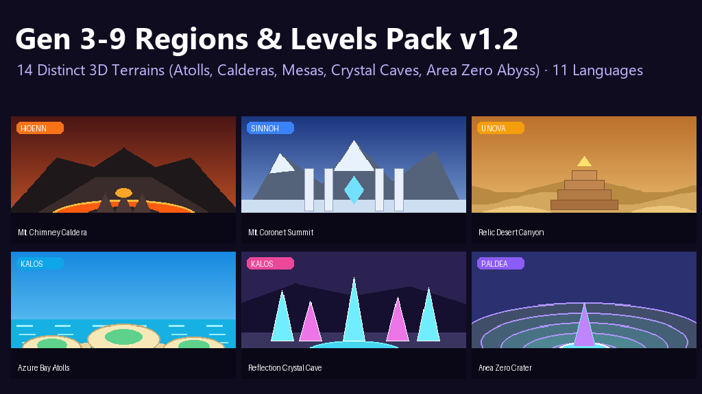
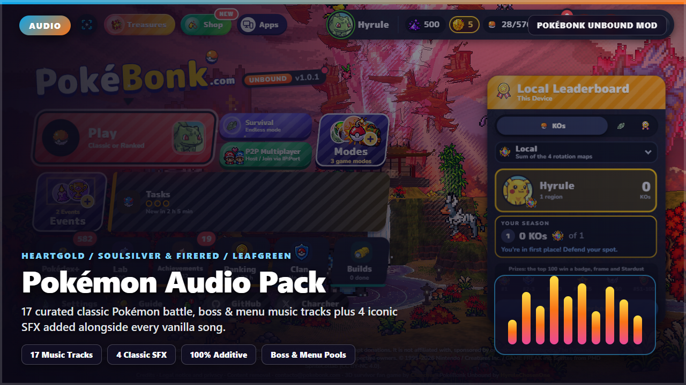
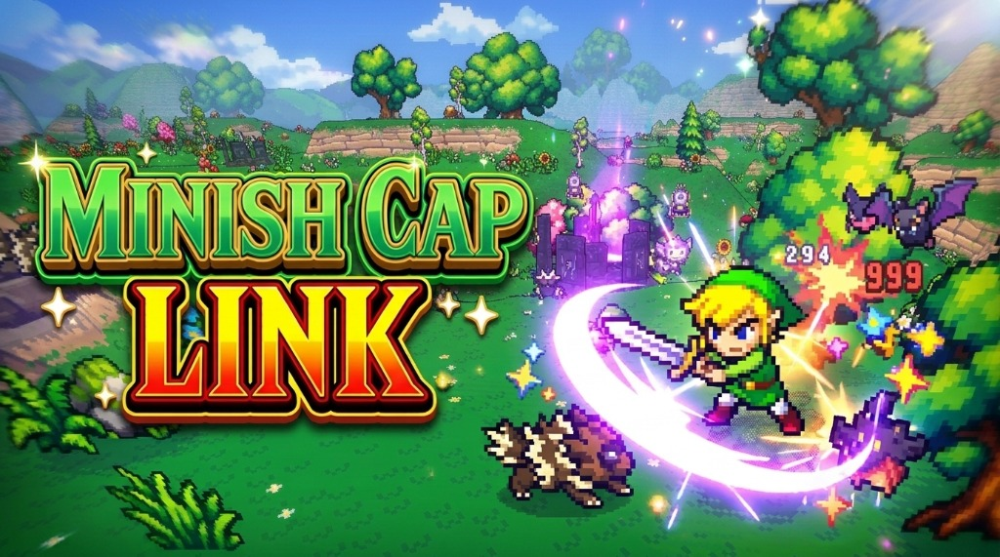

# PokéBonk Unbound — Available Mods Catalog

PokéBonk Unbound releases ship cleanly without bundled mods. Every mod below is 100% optional, runs strictly in **Offline Mode**, and can be installed with 1 click inside **Unbound Settings -> Mod Browser**.

Each mod directory inside `mods-database/<mod-id>/` includes a `mod.json` manifest, an `info.json` showcase file, and a full-sized thumbnail preview image for the in-app Mod Browser.

---

## Quick Overview

| Mod ID | Name | Co-op Scope | Featured | Category | Size | Version | Summary |
| --- | --- | --- | --- | --- | --- | --- | --- |
| `hyrules-mods` | [Hyrule's Collection (QoL & Cheats)](#hyrules-mods) | Client (Optional) | **Essential** (Pinned) | Quality of Life | 1.23 MB | `v1.1.0` | Offline Mode events hub, live main menu customization, P2P multiplayer, and optional solo cheats. |
| `gen3-9-regions-levels` | [Gen 3-9 Regions & Levels Pack (14 Unique Maps)](#gen3-9-regions-levels) | **Gameplay** (Parity Required) | **Featured** | Levels | 2.22 MB | `v1.1.0` | 14 playable levels across Hoenn, Sinnoh, Unova, Kalos, Alola, Galar, and Paldea with custom pixel-art biome textures, thumbnails, and 3D landmarks. |
| `national-dex-gen3-9` | [National Dex Expansion (Gen 3-9: Hoenn to Paldea)](#national-dex-gen3-9) | **Gameplay** (Parity Required) | **Featured** | Characters | 49.23 MB | `v1.1.0` | Expands the playable Pokédex to #1025 with 419 Gen 3-9 families, Dual Shinies (Classic + Alt Palette), 72 clean-named attacks, and 24 Ultimates. |
| `custom-characters-pack` | [Custom & Non-Dexed Pokémon Pack (18 Fighters)](#custom-characters-pack) | **Gameplay** (Parity Required) | — | Characters | 5.91 MB | `v1.3.0` | 18 playable Non-Dexed, Glitch, Beta, Spin-Off, and Mega/Primal Pokémon including MissingNo., Shadow Lugia, Primal Dialga, Bad Egg, Substitute Doll, Beta Arceus, and more. |
| `pokemon-audio-pack` | [Gen 1&2 Soundtrack](#pokemon-audio-pack) | Client (Optional) | — | Audio | 64.17 MB | `v1.1.0` | 43 classic Kanto & Johto music tracks (FRLG, HGSS & GB Sounds) plus 6 iconic SFX added alongside every vanilla song. |
| `minish-cap-link` | [Link (The Minish Cap) — Playable Character & Custom Attacks](#minish-cap-link) | **Gameplay** (Parity Required) | — | Characters | 1.55 MB | `v1.0.0` | Playable Link from The Minish Cap with 8-direction sprites, 5 custom attacks, dedicated custom VFX, and Four Sword Ultimate. |

---

## Mod Details

### Hyrule's Collection (QoL & Cheats) *(Essential · Pinned)*

- **ID**: `hyrules-mods`
- **Co-op Scope**: Client-side (optional in Co-op; safe to differ between players)
- **Category**: Quality of Life (**Featured**)
- **Size**: 1.23 MB (3 files)
- **Version**: `v1.1.0`
- **Author**: HyruleChosenOne
- **Requirements**: Offline Mode (Mod Engine ON)
- **Info File**: [`mods-database/hyrules-mods/info.json`](mods-database/hyrules-mods/info.json)
- **Tags**: `qol`, `collection`, `enabler`, `events`, `p2p`, `themes`, `cheats`, `unlocks`

All-in-one Offline Mode Quality-of-Life, Enablers, and Trainer Cheats collection by HyruleChosenOne. Restores past seasonal events in a dedicated Choose-Mode hub without altering your wallpaper or music, unlocks direct IP:Port P2P Co-op multiplayer, and adds live 3D main menu diorama and music selectors alongside optional solo speed/combat cheats and save utilities.

**Highlights:**
- Events Enabler restoring Lavender Tower Night and Mewtwo Strikes Back in a dedicated hub
- Direct IP:Port Peer-to-Peer Co-op multiplayer hosting and joining
- Live 3D Main Menu Wallpaper and Music selector (supports additive custom music)
- Optional solo Offline cheats (Run Speed 1x/1.5x/2x, God Mode, Overdrive, Unlock All Difficulties, Unlock All Wardrobe, and Trainer Save Utilities)

### Gen 3-9 Regions & Levels Pack (14 Unique Maps) *(Featured)*

- **ID**: `gen3-9-regions-levels`
- **Co-op Scope**: Gameplay (all Co-op players must enable the same version)
- **Category**: Levels (**Featured**)
- **Size**: 2.22 MB (87 files)
- **Version**: `v1.1.0`
- **Author**: HyruleChosenOne
- **Requirements**: Offline Mode (Mod Engine ON; works standalone or with National Dex Gen 3-9)
- **Info File**: [`mods-database/gen3-9-regions-levels/info.json`](mods-database/gen3-9-regions-levels/info.json)
- **Tags**: `levels`, `regions`, `maps`, `gen3`, `gen4`, `gen5`, `gen6`, `gen7`, `gen8`, `gen9`

Standalone regional levels expansion adding all 7 Gen 3-9 regions to PokéBonk's Map Picker with 2 distinct maps each (14 levels total). Every map features custom PokéBonk-style pixel-art terrain, cliff, path, and prop textures, bespoke Map Picker artwork, accurate biome lighting and weather pools, sanctuary arenas, regional encounters, and textured 3D centerpiece landmarks with authentic props. Works completely standalone with vanilla Kanto/Johto Pokémon or paired with National Dex Expansion (Gen 3-9).

**Highlights:**
- Hoenn: Petalburg Canopy & Mt. Chimney Caldera
- Sinnoh: Mt. Coronet Spear Pillar & Eterna Forest Chateau
- Unova: Desert Resort Relic Castle & Dragonspiral Tower
- Kalos: Azure Bay Sea Arch & Reflection Cave Prisms
- Alola: Melemele Tapu Ruins & Wela Volcano Fire Altar
- Galar: Galar Wild Area Dynamax Den & Crown Tundra Temple
- Paldea: Asado Desert Titan Mesa & Area Zero Terastal Spire

### National Dex Expansion (Gen 3-9: Hoenn to Paldea) *(Featured)*

- **ID**: `national-dex-gen3-9`
- **Co-op Scope**: Gameplay (all Co-op players must enable the same version)
- **Category**: Characters (**Featured**)
- **Size**: 49.23 MB (3099 files)
- **Version**: `v1.1.0`
- **Author**: HyruleChosenOne
- **Requirements**: Offline Mode (Mod Engine ON)
- **Info File**: [`mods-database/national-dex-gen3-9/info.json`](mods-database/national-dex-gen3-9/info.json)
- **Tags**: `gen3`, `gen4`, `gen5`, `gen6`, `gen7`, `gen8`, `gen9`, `custom-moves`, `dual-shinies`, `national-dex`

Complete Gen 3 through Gen 9 character and moveset expansion covering Hoenn, Sinnoh, Unova, Kalos, Alola, Galar, and Paldea (#252-#1025). Adds 419 playable base evolution families, 774 species with animated sprites, official shiny palettes mapped to Classic Shiny plus bespoke alternative-palette Shiny sprites for every single Gen 3-9 Pokémon, 72 custom Gen 3-9 attacks across all 18 types with clean attack names, and 24 custom signature Ultimates. Pure Pokémon and attacks pack with zero bundled levels; pair with Gen 3-9 Regions & Levels Pack for regional maps.

**Highlights:**
- Expands the Pokédex cap from #251 to #1025 across all 7 Gen 3-9 regions (419 playable families, 774 species)
- Dual Shinies for all 774 Gen 3-9 Pokémon: official shiny colors as Classic Shiny + custom alternative-palette sprites as Shiny
- 72 custom Gen 3-9 attacks across all 18 types with clean canonical attack names rendered via PokéBonk's native GPU VFX engine
- 24 custom Ultimates (Rayquaza, Lucario, Garchomp, Greninja, Zacian, Koraidon, Miraidon, Raging Bolt, Terapagos, and more)
- Characters start locked by default for progression, with per-generation unlock tools in Unbound Settings

### Custom & Non-Dexed Pokémon Pack (18 Fighters)

- **ID**: `custom-characters-pack`
- **Co-op Scope**: Gameplay (all Co-op players must enable the same version)
- **Category**: Characters
- **Size**: 5.91 MB (87 files)
- **Version**: `v1.3.0`
- **Author**: HyruleChosenOne
- **Requirements**: Offline Mode (Mod Engine ON)
- **Info File**: [`mods-database/custom-characters-pack/info.json`](mods-database/custom-characters-pack/info.json)
- **Tags**: `custom-characters`, `non-dexed`, `missingno`, `shadow-lugia`, `primal-dialga`, `beta-pokemon`, `custom-attacks`, `custom-vfx`, `custom-items`, `forms`

Expands the core Custom region (#2000-#9999) with 18 fully animated playable fighters: 13 iconic Non-Dexed, Glitch, Beta, and Spin-Off legends (MissingNo. with animated Gen 1 glitch sprites and DMG-Green Shiny, Substitute Doll, Bad Egg, Shadow Lugia XD001, Primal Dialga, Shadow Mewtwo, Eternal Flower Floette, Ultra Necrozma, Beta Arceus, Purple Kecleon, Mikon Beta Vulpix, Pikachu Libre, and Hakogame Beta Turtle) plus 5 Special Forms (Mega Rayquaza, Primal Groudon, Primal Kyogre, Mega Mewtwo X, and Ash-Greninja). Every fighter includes 8-direction animations, portraits, signature custom attacks with Core Custom VFX, and custom Ultimates.

**Highlights:**
- Glitch & Oddity icons: MissingNo. (#2011, with custom animated glitch sheet & DMG-Green Shiny), Substitute Doll (#2012), and Bad Egg (#2013)
- Spin-Off & Unreleased legends: Shadow Lugia XD001 (#2014), Primal Dialga (#2015), Shadow Mewtwo (#2016), Eternal Flower Floette (#2017), Ultra Necrozma (#2018), Beta Arceus (#2019), Purple Kecleon (#2020), Mikon (#2021), Pikachu Libre (#2022), and Hakogame (#2023)
- Special Forms: Mega Rayquaza, Primal Groudon, Primal Kyogre, Mega Mewtwo X, and Ash-Greninja
- 37 signature custom attacks, 15 custom GPU VFX presets, 18 custom Ultimates, and 5 custom Pokéball pickup items
- Drop-in ./characters/ folder support — runs natively via the Core Modding API (no separate enabler mod required)

### Gen 1&2 Soundtrack

- **ID**: `pokemon-audio-pack`
- **Co-op Scope**: Client-side (optional in Co-op; safe to differ between players)
- **Category**: Audio
- **Size**: 64.17 MB (52 files)
- **Version**: `v1.1.0`
- **Author**: HyruleChosenOne
- **Requirements**: Offline Mode (Mod Engine ON)
- **Info File**: [`mods-database/pokemon-audio-pack/info.json`](mods-database/pokemon-audio-pack/info.json)
- **Tags**: `audio`, `music`, `sfx`, `gen1`, `gen2`, `kanto`, `johto`, `frlg`, `hgss`, `soundtrack`

Expanded additive Gen 1 & Gen 2 Pokémon soundtrack and sound effects mod curated from FireRed/LeafGreen, HeartGold/SoulSilver, and authentic 8-bit GB Sounds archives. Registers 10 nostalgic menu themes, 20 battle/route/dungeon themes into the in-game music rotation, 13 legendary & champion boss themes into the boss pool, and 6 classic SFX stings — all without overwriting or removing a single vanilla PokéBonk track.

**Highlights:**
- 10 selectable main menu themes: Title Screen (FRLG & HGSS), Pallet Town, New Bark Town, National Park, Route 1, Route 29, Goldenrod, Ecruteak & Cerulean City
- 20 in-game battle & dungeon themes: Wild, Trainer, Gym Leader, Rival, Team Rocket, Rocket Hideout, Silph Co., Victory Road, Pokémon Tower, Battle Tower & GB Sounds classics
- 13 legendary & champion boss themes: Mewtwo, Legendary Birds, Deoxys, Champion Blue/Lance/Red, Ho-Oh, Lugia, Raikou, Entei, Suicune, Frontier Brain & Super-Ancient
- 6 short iconic SFX clips (Level Up, Item Get, Heal, Caught, Badge Get & Evolution) routed through PokéBonk's native SFX slider
- 100% additive — every vanilla PokéBonk song remains selectable and intact

### Link (The Minish Cap) — Playable Character & Custom Attacks

- **ID**: `minish-cap-link`
- **Co-op Scope**: Gameplay (all Co-op players must enable the same version)
- **Category**: Characters
- **Size**: 1.55 MB (8 files)
- **Version**: `v1.0.0`
- **Author**: HyruleChosenOne
- **Requirements**: Offline Mode (Mod Engine ON)
- **Info File**: [`mods-database/minish-cap-link/info.json`](mods-database/minish-cap-link/info.json)
- **Tags**: `character`, `zelda`, `minish-cap`, `custom-attacks`, `custom-vfx`, `custom-items`

Brings Link from The Legend of Zelda: The Minish Cap into PokéBonk as a fully animated playable fighter in the Custom region (#2010). Features complete 8-direction walk, idle, attack, and hurt spritesheets, a Four Sword Red shiny variant, 5 signature Minish Cap custom attacks built with the Core Custom VFX engine, a custom Four Sword Hurricane Spin Ultimate, and 2 Hyrule Pokéball pickup items.

**Highlights:**
- Full 8-direction GBA-style animated spritesheet plus Four Sword Red shiny variant
- 5 custom attacks: Picori Blade, Magical Boomerang, Gust Jar, Cane of Pacci, and Flame Lantern
- 5 custom GPU VFX presets showcasing dual-color slash arcs, returning crescents, gale waves, magic beams, and flame rings
- Custom Ultimate: Four Sword Hurricane Spin with rune/petal shockwaves and slash bursts
- 2 custom Pokéball items: Gold Kinstone and Pegasus Boots

---

## Installing Mods

1. Open **Unbound Settings** from the top toolbar (Desktop) or floating **Unbound** button (Android).
2. Switch to the **Mod Browser** tab.
3. Click **Install** on any mod you want — downloaded mods are automatically enabled by default in Offline Mode.

Want to create or publish your own mod? See [docs/MODDING.md](docs/MODDING.md).
