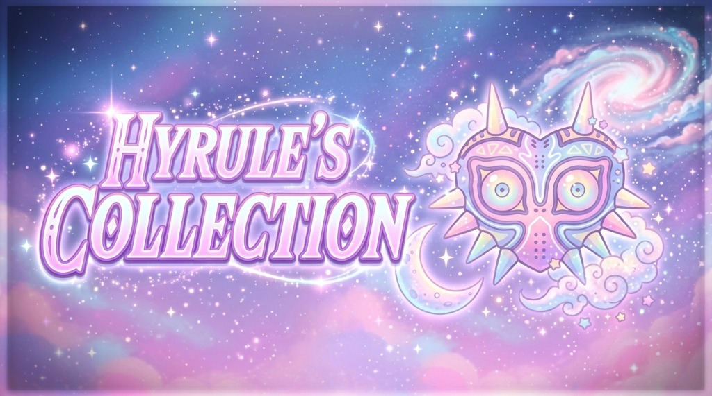
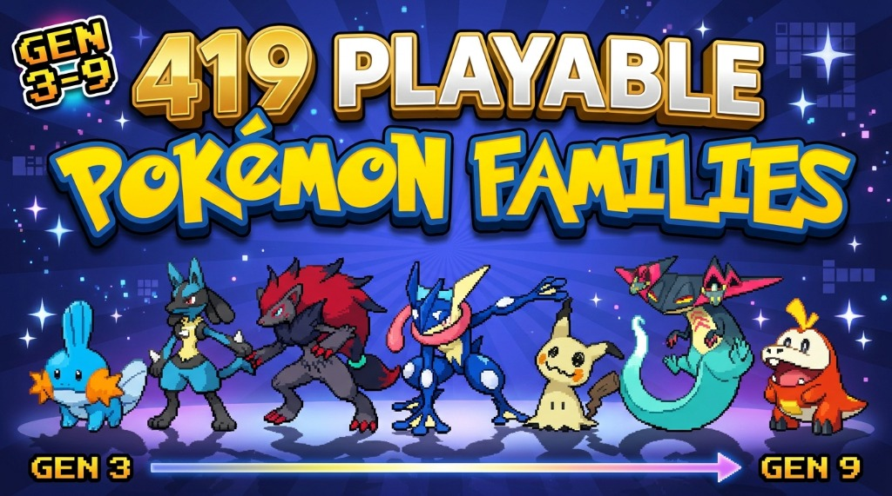
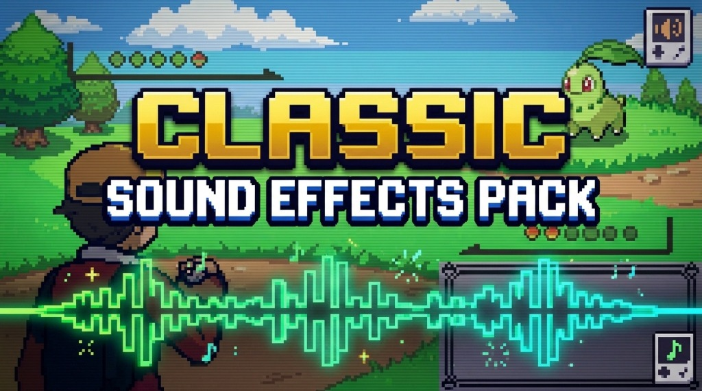
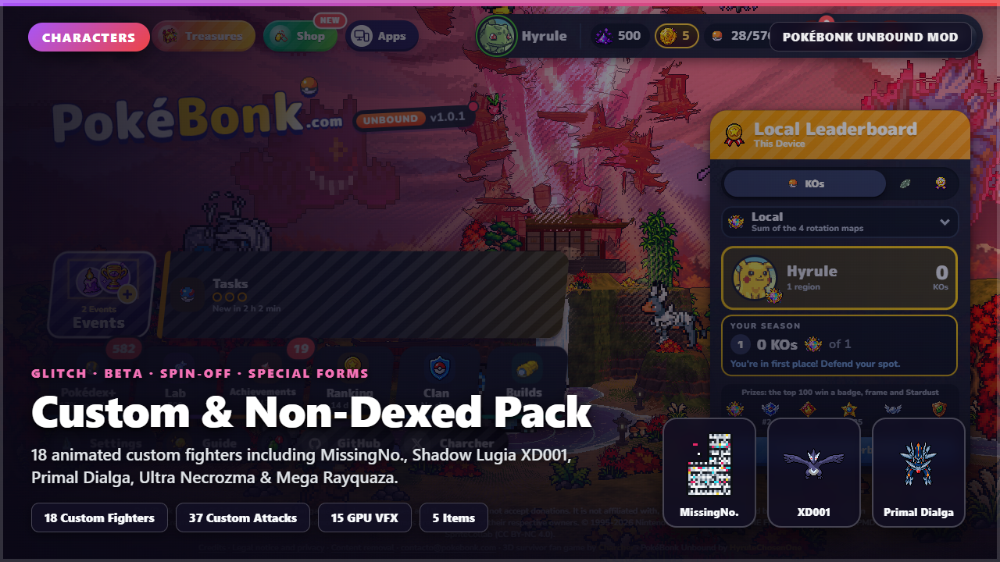

# PokéBonk Unbound — Available Mods Catalog

PokéBonk Unbound releases ship cleanly without bundled mods. Every mod below is 100% optional, runs strictly in **Offline Mode**, and can be installed with 1 click inside **Unbound Settings -> Mod Browser**.

Each mod directory inside `mods-database/<mod-id>/` includes a `mod.json` manifest, an `info.json` showcase file, and a full-sized thumbnail preview image for the in-app Mod Browser.

---

## Curated Modpacks

Install multi-mod collections together with 1 click inside **Unbound Settings -> Mod Browser -> Modpacks**.

| Pack ID | Name | Included Mods | Scope | Summary |
| --- | --- | --- | --- | --- |
| `gen3-9-complete-expansion` | **Gen 3-9 Complete Expansion** | `national-dex-gen3-9` + `gen3-9-regions-levels` | **Gameplay** | Gen 3-9 Characters + Gen 3-9 Stages bundled together in 1 click. |
| `classic-gen1-2-audio-collection` | **Classic Gen 1&2 Audio Collection** | `pokemon-audio-pack` + `classic-sfx-pack` | Client | Gen 1&2 Soundtrack (53 FRLG/HGSS tracks covering all events) + Classic Sound Effects (94 Emerald menu/attack SFX & Gen 3 fanfares) bundled together. |

---

## Quick Overview

| Mod ID | Name | Co-op Scope | Featured | Category | Size | Version | Summary |
| --- | --- | --- | --- | --- | --- | --- | --- |
| `hyrules-mods` | [Hyrule's Collection (QoL & Cheats)](#hyrules-mods) | Client (Optional) | **Essential** (Pinned) | Quality of Life | 1.26 MB | `v1.3.2` | Offline Mode events hub, live main menu customization, P2P multiplayer, experimental Co-op Expeditions, solo cheats, and full profile unlocks. |
| `gen3-9-regions-levels` | [Gen 3-9 Regions & Levels Pack (14 Unique Maps)](#gen3-9-regions-levels) | **Gameplay** (Parity Required) | **Featured** | Levels | 24.56 MB | `v1.3.1` | 14 playable levels across Hoenn, Sinnoh, Unova, Kalos, Alola, Galar, and Paldea with custom biome textures, real in-game 3D level screenshots, and 3D landmarks. |
| `national-dex-gen3-9` | [National Dex Expansion (Gen 3-9: Hoenn to Paldea)](#national-dex-gen3-9) | **Gameplay** (Parity Required) | **Featured** | Characters | 65.64 MB | `v1.2.2` | Expands the playable Pokédex to #1025 with 774 fully animated Pokémon (0 static sprites), Dual Shinies, 72 attacks, 24 Ultimates & 11-language translation. |
| `classic-sfx-pack` | [Classic Sound Effects Pack](#classic-sfx-pack) | Client (Optional) | — | Audio | 2.22 MB | `v1.1.2` | Authentic Pokémon Emerald menu UI, Poké Ball, battle hit, and attack/move SFX + classic Gen 3 fanfares. |
| `pokemon-audio-pack` | [Gen 1&2 Soundtrack](#pokemon-audio-pack) | Client (Optional) | — | Audio | 83.29 MB | `v1.3.3` | 53 authentic FRLG, HGSS & GB Sounds tracks covering EVERY PokéBonk song including all seasonal events. |
| `custom-characters-pack` | [Non-Dexed Pokémon Pack (18 Fighters)](#custom-characters-pack) | **Gameplay** (Parity Required) | — | Characters | 9.85 MB | `v2.0.1` | 18 fully animated Non-Dexed, Glitch, Beta, Spin-Off & Special Form Pokémon with Dual Shinies, 37 attacks, 18 Ultimates & 11-language translation. |
| `minish-cap-link` | [The Minish Cap Showcase Pack (Test Mod — Link & Zelda)](#minish-cap-link) | **Gameplay** (Parity Required) | — | Characters | 5.55 MB | `v3.0.1` | Test & showcase mod demonstrating PokéBonk Unbound modding capabilities: custom fighters, movesets, VFX, SFX/cries, Wardrobe skins, and 3D stages. |

---

## Mod Details

### Hyrule's Collection (QoL & Cheats) *(Essential · Pinned)*

- **ID**: `hyrules-mods`
- **Co-op Scope**: Client-side (optional in Co-op; safe to differ between players)
- **Category**: Quality of Life (**Featured**)
- **Size**: 1.26 MB (5 files)
- **Version**: `v1.3.2`
- **Author**: HyruleChosenOne
- **Requirements**: Offline Mode (Mod Engine ON)
- **Info File**: [`mods-database/hyrules-mods/info.json`](mods-database/hyrules-mods/info.json)
- **Tags**: `qol`, `collection`, `enabler`, `events`, `p2p`, `themes`, `cheats`, `unlocks`

All-in-one Offline Mode Quality-of-Life, Enablers, and Trainer Cheats collection by HyruleChosenOne. Restores past seasonal events in a dedicated Choose-Mode hub, unlocks direct IP:Port P2P Co-op multiplayer with Local Lobbies browser and an experimental Co-op Expeditions (2-4P) mode integrated into Co-op menus, adds live 3D main menu diorama and music selectors, and provides reworked Solo Combat Cheats (Run Speed 1x-3x, God Mode, Overdrive, Turbo XP, Super Magnet & Luck, Instant Ultimate), Unlock All Clan & Rank Rewards, Unlock All (Full Profile Customization), Max Friendship, Complete Quests, and Trainer Save Utilities.

**Highlights:**
- Events Enabler restoring Lavender Tower Night and Mewtwo Strikes Back in a dedicated hub
- Direct IP:Port Peer-to-Peer Co-op multiplayer with UDP Local Lobbies browser & 1-click Mod Sync
- Experimental Co-op Expeditions (2-4P) toggle adding Expedition mode directly to Co-op menus with synced Expedition Base transitions for all players
- Live 3D Main Menu Wallpaper and Music selector (supports additive custom music)
- Solo Combat Cheats: Run Speed 1x/1.5x/2x/3x, God Mode, Overdrive, Turbo XP (5x), Super Magnet & Luck, Instant Ultimate, Unlock All Difficulties
- Full Unlocks: Unlock All (Full Profile Customization), Unlock All Clan & Rank Rewards, Unlock All Wardrobe & Shinies, Max Friendship (Lv. 20), Complete All Quests

### Gen 3-9 Regions & Levels Pack (14 Unique Maps) *(Featured)*

- **ID**: `gen3-9-regions-levels`
- **Co-op Scope**: Gameplay (all Co-op players must enable the same version)
- **Category**: Levels (**Featured**)
- **Size**: 24.56 MB (102 files)
- **Version**: `v1.3.1`
- **Author**: HyruleChosenOne
- **Requirements**: Offline Mode (Mod Engine ON; works standalone or with National Dex Gen 3-9)
- **Info File**: [`mods-database/gen3-9-regions-levels/info.json`](mods-database/gen3-9-regions-levels/info.json)
- **Tags**: `levels`, `regions`, `maps`, `gen3`, `gen4`, `gen5`, `gen6`, `gen7`, `gen8`, `gen9`, `music`, `i18n`, `custom-terrain`

Adds 14 custom stages across Hoenn to Paldea with distinct 3D topographies, landmarks, harmonized textures, and region OSTs.

**Highlights:**
- Hoenn: Petalburg Canopy & Mt. Chimney Caldera
- Sinnoh: Mt. Coronet Spear Pillar & Eterna Forest Chateau
- Unova: Desert Resort Relic Castle & Dragonspiral Tower
- Kalos: Azure Bay Sea Arch & Reflection Cave Prisms
- Alola: Melemele Tapu Ruins & Wela Volcano Fire Altar
- Galar: Galar Wild Area Dynamax Den & Crown Tundra Temple
- Paldea: Asado Desert Titan Mesa & Area Zero Terastal Spire

### National Dex Expansion (Gen 3-9: Hoenn to Paldea) *(Featured)*

- **ID**: `national-dex-gen3-9`
- **Co-op Scope**: Gameplay (all Co-op players must enable the same version)
- **Category**: Characters (**Featured**)
- **Size**: 65.64 MB (3175 files)
- **Version**: `v1.2.2`
- **Author**: HyruleChosenOne
- **Requirements**: Offline Mode (Mod Engine ON)
- **Info File**: [`mods-database/national-dex-gen3-9/info.json`](mods-database/national-dex-gen3-9/info.json)
- **Tags**: `gen3`, `gen4`, `gen5`, `gen6`, `gen7`, `gen8`, `gen9`, `custom-moves`, `dual-shinies`, `national-dex`, `i18n`

Complete Gen 3 through Gen 9 character and moveset expansion covering Hoenn, Sinnoh, Unova, Kalos, Alola, Galar, and Paldea (#252-#1025). Adds 419 playable base evolution families, 774 species with 100% animated multi-frame sprites (including upgraded Copperajah and all Gen 7-9 species with zero static sheets), Dual Shinies (official Classic Shiny + custom alternative-palette Shiny), 72 custom Gen 3-9 attacks across all 18 types, 24 custom signature Ultimates, and full 11-language global localization (EN, ES, PT, FR, DE, IT, JA, KO, RU, ZH, ZHT).

**Highlights:**
- Expands the Pokédex cap from #251 to #1025 across all 7 Gen 3-9 regions (419 playable families, 774 fully animated species — 0 static sprites)
- Full 11-language global localization for all 774 Pokémon names, 72 custom moves, 24 Ultimates, roles, and regions
- Dual Shinies for all 774 Gen 3-9 Pokémon: official shiny colors as Classic Shiny + custom alternative-palette sprites as Shiny
- 72 custom Gen 3-9 attacks across all 18 types rendered via PokéBonk native GPU VFX engine
- 24 custom Ultimates (Rayquaza, Lucario, Garchomp, Greninja, Zacian, Koraidon, Miraidon, Raging Bolt, Terapagos, and more)

### Classic Sound Effects Pack

- **ID**: `classic-sfx-pack`
- **Co-op Scope**: Client-side (optional in Co-op; safe to differ between players)
- **Category**: Audio
- **Size**: 2.22 MB (97 files)
- **Version**: `v1.1.2`
- **Author**: HyruleChosenOne
- **Requirements**: Offline Mode (Mod Engine ON)
- **Info File**: [`mods-database/classic-sfx-pack/info.json`](mods-database/classic-sfx-pack/info.json)
- **Tags**: `audio`, `sfx`, `sound-effects`, `emerald`, `frlg`, `gen3`, `classic`, `menus`, `attacks`

Overhauls PokéBonk with 94 authentic Gen 3 sound effects: genuine Pokémon Emerald menu & UI sounds (SE_SELECT confirm, cursor scroll, denied buzzer, Poké Mart shop, save, PokéNav, EXP bar pip, Shiny sparkle, Poké Ball throw/open/shake/click), Emerald battle effectiveness hits & Faint KO, 47 authentic Emerald move & attack sounds wired directly into PokéBonk's move dispatcher (Ember, Flamethrower, Surf, Hydro Pump, Thunderbolt, Razor Leaf, Solar Beam, Ice Beam, Blizzard, Psybeam, Shadow Ball, Bite, Brick Break, Earthquake, Hyper Beam, Explosion, and more), plus 16 Gen 3 milestone fanfares.

**Highlights:**
- Authentic Pokémon Emerald menu & UI SFX (SE_SELECT confirm, cursor scroll, denied buzzer, item use, shop, save, PokéNav, Shiny sparkle, Poké Ball capture)
- 47 authentic Pokémon Emerald move & elemental attack SFX hooked directly into PokéBonk's per-move audio engine across all 144+ moves & all 18 types
- Genuine Emerald effectiveness hits (Normal / Super Effective / Not Very Effective), Faint KO, ledge hop, and flee dash
- 16 classic Gen 3 milestone fanfares (Level Up!, Healed, Caught!, Evolved!, Victory, Defeat, Jackpot, Boss Intro) — 100% Client-side & Co-op safe

### Gen 1&2 Soundtrack

- **ID**: `pokemon-audio-pack`
- **Co-op Scope**: Client-side (optional in Co-op; safe to differ between players)
- **Category**: Audio
- **Size**: 83.29 MB (62 files)
- **Version**: `v1.3.3`
- **Author**: HyruleChosenOne
- **Requirements**: Offline Mode (Mod Engine ON)
- **Info File**: [`mods-database/pokemon-audio-pack/info.json`](mods-database/pokemon-audio-pack/info.json)
- **Tags**: `audio`, `music`, `gen1`, `gen2`, `kanto`, `johto`, `frlg`, `hgss`, `events`, `soundtrack`

Complete Gen 1 & Gen 2 Pokémon soundtrack curated from FireRed/LeafGreen, HeartGold/SoulSilver, and GB Sounds (53 tracks total). Covers every single PokéBonk song including Main Menu, Halloween / Lavender Tower Night (Lavender Town FRLG), Johto Ecruteak Sunset (Bell Tower HGSS), Dynamax Sky (Sinjoh Ruins HGSS), Mewtwo Strikes Back Boss Rush (Battle! Mewtwo FRLG), all 5 In-Game battle themes, dungeons, and legendary/champion bosses. Pairs seamlessly with Classic Sound Effects via the Classic Gen 1&2 Audio Collection Modpack.

**Highlights:**
- Covers EVERY PokéBonk song & seasonal event: Main Menu, Lavender Tower Night, Johto Sunset, Dynamax Sky, Mewtwo Boss Rush, all 5 In-Game slots, and Bosses
- 53 curated FireRed/LeafGreen, HeartGold/SoulSilver, and 8-bit GB Sounds tracks
- Configurable default Title Screen / Main Menu theme right in Mod Configs
- Client-side audio mod: safe to use in P2P Co-op even if teammates don't have it installed

### Non-Dexed Pokémon Pack (18 Fighters)

- **ID**: `custom-characters-pack`
- **Co-op Scope**: Gameplay (all Co-op players must enable the same version)
- **Category**: Characters
- **Size**: 9.85 MB (157 files)
- **Version**: `v2.0.1`
- **Author**: HyruleChosenOne
- **Requirements**: Offline Mode (Mod Engine ON)
- **Info File**: [`mods-database/custom-characters-pack/info.json`](mods-database/custom-characters-pack/info.json)
- **Tags**: `custom-characters`, `non-dexed`, `missingno`, `shadow-lugia`, `primal-dialga`, `beta-pokemon`, `custom-attacks`, `custom-vfx`, `custom-items`, `forms`, `dual-shinies`, `i18n`

Polished 18-fighter Non-Dexed Pokémon Pack (#2001-#2023) featuring 13 iconic Non-Dexed, Glitch, Beta, and Spin-Off legends (MissingNo., Substitute Doll, Bad Egg, Shadow Lugia XD001, Primal Dialga, Shadow Mewtwo, Eternal Flower Floette, Ultra Necrozma, Beta Arceus, Purple Kecleon, Mikon Beta Vulpix, Pikachu Libre, and Hakogame Beta Turtle) plus 5 Special Forms (Mega Rayquaza, Primal Groudon, Primal Kyogre, Mega Mewtwo X, and Ash-Greninja). Matches the full Gen 3-9 expansion standard with 100% animated multi-frame sprites (0 static sprites), Dual Shinies (Classic Shiny + bespoke Alt-Palette Shiny) for every fighter, 37 custom attacks, 15 custom VFX presets, 18 custom Ultimates, 5 custom items, and complete 11-language global localization.

**Highlights:**
- 18 fully animated Non-Dexed fighters (0 static sprites, including upgraded Mega Mewtwo X & Ash-Greninja animated sheets)
- Dual Shinies (Classic Shiny + bespoke Alt-Palette Shiny) for every single fighter including DMG-Green & Cyber-Violet MissingNo.
- Complete 11-language global localization (EN, ES, PT, FR, DE, IT, JA, KO, RU, ZH, ZHT) for all 18 fighters, roles, 37 moves, 18 Ultimates, and 5 items
- Glitch, Beta & Spin-Off icons: MissingNo., Substitute Doll, Bad Egg, Shadow Lugia XD001, Primal Dialga, Shadow Mewtwo, Eternal Flower Floette, Ultra Necrozma, Beta Arceus, Purple Kecleon, Mikon, Pikachu Libre, and Hakogame
- 5 Special Forms: Mega Rayquaza, Primal Groudon, Primal Kyogre, Mega Mewtwo X, and Ash-Greninja with 37 attacks & 15 GPU VFX

### The Minish Cap Showcase Pack (Test Mod — Link & Zelda)

- **ID**: `minish-cap-link`
- **Co-op Scope**: Gameplay (all Co-op players must enable the same version)
- **Category**: Characters
- **Size**: 5.55 MB (55 files)
- **Version**: `v3.0.1`
- **Author**: HyruleChosenOne
- **Requirements**: Offline Mode (Mod Engine ON)
- **Info File**: [`mods-database/minish-cap-link/info.json`](mods-database/minish-cap-link/info.json)
- **Tags**: `character`, `zelda`, `minish-cap`, `hyrule`, `dark-world`, `levels`, `custom-attacks`, `custom-vfx`, `custom-items`, `fusion`, `i18n`, `music`

Note: This is a test/showcase mod built to demonstrate PokéBonk Unbound's modding capabilities rather than a polished standalone release. It showcases custom playable characters (Young Link with OOT cries & Princess Zelda with Wind Waker HD voice SFX, both unlocked by default), 6 Wardrobe skins each, dedicated exclusive movesets for both characters (9 Minish Cap sword/item moves for Link + 9 custom Triforce & Goddess magic moves for Zelda, zero vanilla PokéBonk moves), Light Arrows Signature Fusion, custom Ultimates, and 2 unlocked 3D stages (Hyrule Castle & Pyramid of Power) with looping ALttP SNES OSTs.

**Highlights:**
- Test/showcase mod demonstrating custom characters, movesets, VFX, SFX, Wardrobe skins, fusions, and 3D landmarks
- Playable Young Link (#2010, OOT 3D cries) & Princess Zelda (#2024, Wind Waker HD voice SFX) — both unlocked by default
- Separate exclusive movesets: 9 Minish Cap Sword/Item moves for Link + 9 Goddess & Triforce Magic moves for Zelda (zero vanilla moves)
- 6 Wardrobe skins each + Light Arrows Fusion + 3D Hyrule Castle & Pyramid of Power stages with looping ALttP OSTs

---

## Installing Mods

1. Open **Unbound Settings** from the Offline Main Menu (**Unbound Menu** button, Pause Menu on Desktop Modded, or `F1` top toolbar; floating **Unbound** button on Android/iOS).
2. Switch to the **Mod Browser** tab.
3. Click **Install** on any official or approved community mod — downloaded mods are automatically enabled in Offline Mode.

## Community Mods (`community-mods/`)

No approved community mods yet — submit yours for manual review via the **[Community Mod Submission Form](https://github.com/HyruleChosenOne/Pokebonk-Unbound/issues/new?template=submit-community-mod.yml)** or see [`community-mods/README.md`](community-mods/README.md).

Want to create or publish your own mod? See [docs/MODDING.md](docs/MODDING.md).
